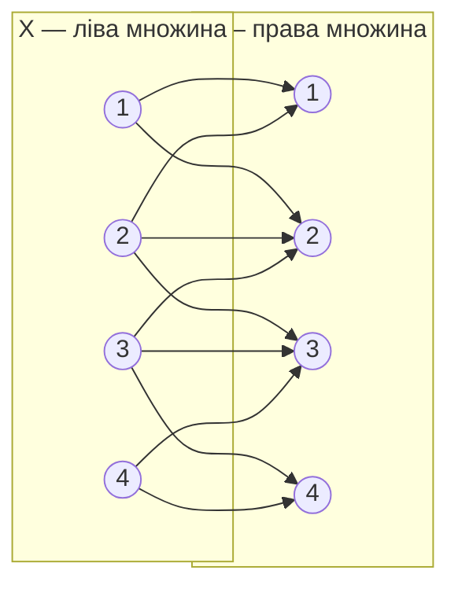
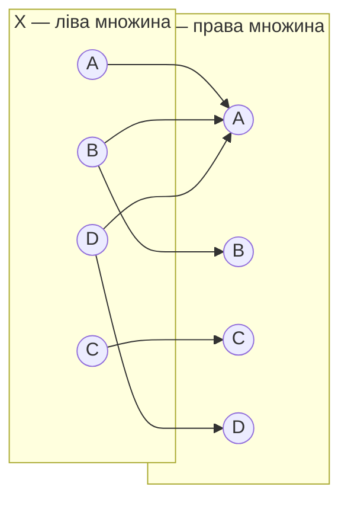
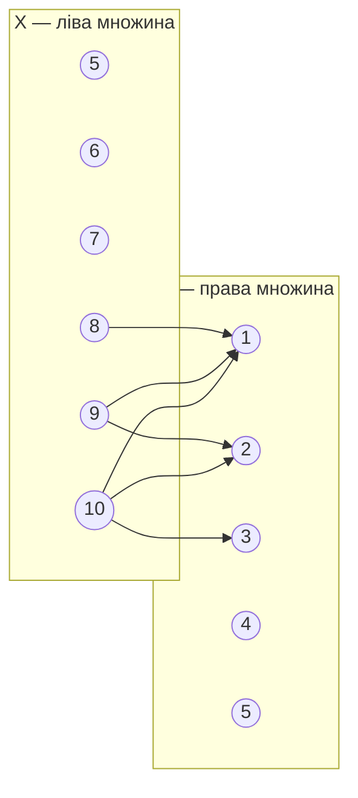
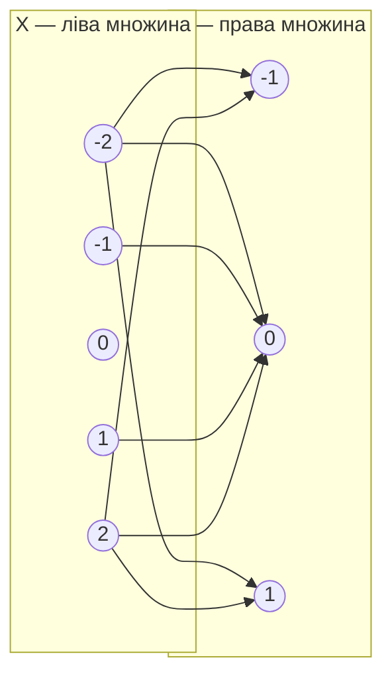
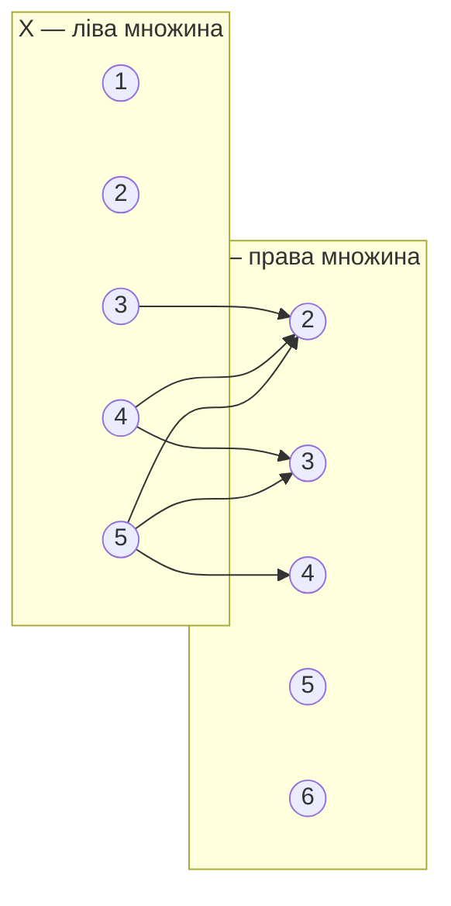
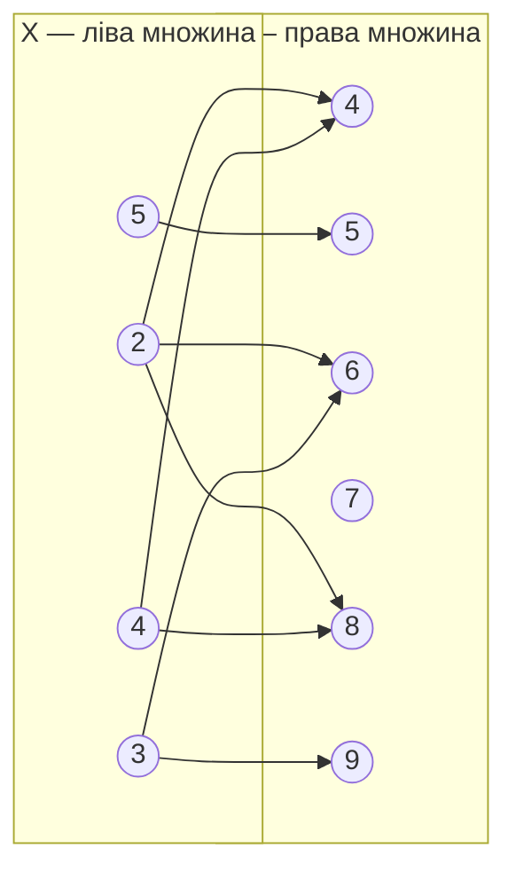
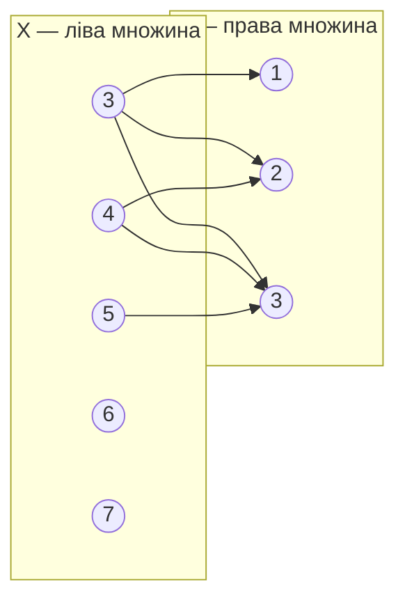
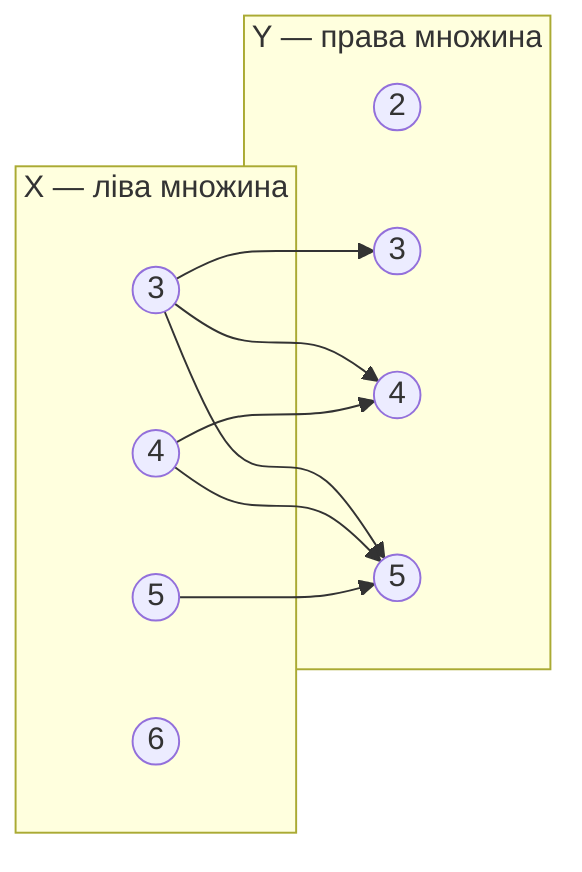
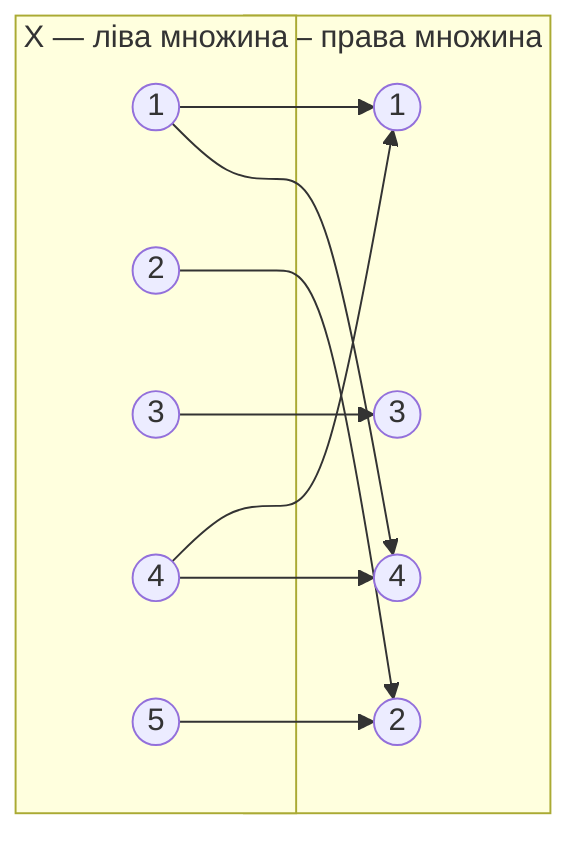

# Домашнє завдання 5
## Відношення: способи задання, область визначення і значень

У матрицях зліва вказані елементи X, зверху — елементи Y. Якщо пара належить R, ставимо 1, інакше — 0. D(R) — область визначення, E(R) — область значень. На графах стрілки йдуть від X до Y.

### Завдання 1.1

X={1, 2, 3, 4}, Y={1, 2, 3, 4}, R = {(x,y): |x-y|≤1}.

Перевіряємо, щоб різниця чисел за модулем не перевищувала 1.

Перелік пар:

R={(1,1), (1,2), (2,1), (2,2), (2,3), (3,2), (3,3), (3,4), (4,3), (4,4)}.

Матриця:

| x / y | 1 | 2 | 3 | 4 |
|---|---|---|---|---|
| 1 | 1 | 1 | 0 | 0 |
| 2 | 1 | 1 | 1 | 0 |
| 3 | 0 | 1 | 1 | 1 |
| 4 | 0 | 0 | 1 | 1 |

Дводольний граф:

Відповідь: D(R)={1, 2, 3, 4}, E(R)={1, 2, 3, 4}.

---

### Завдання 1.2

X={A, B, C, D}, Y={A, B, C, D}, R = {(x,y): x ∖ y=∅}.

Маємо x ∖ y=∅ ↔ x⊆ y. Тут A={0,1,2,3}, B={0,2}, C={1,3,4}, D={1,2,3}. Крім включення кожної множини в себе, маємо B⊆ A та D⊆ A.

Перелік пар:

R={(A,A), (B,A), (B,B), (C,C), (D,A), (D,D)}.

Матриця:

| x / y | A | B | C | D |
|---|---|---|---|---|
| A | 1 | 0 | 0 | 0 |
| B | 1 | 1 | 0 | 0 |
| C | 0 | 0 | 1 | 0 |
| D | 1 | 0 | 0 | 1 |

Дводольний граф:

Відповідь: D(R)={A, B, C, D}, E(R)={A, B, C, D}.

---

### Завдання 2.1

X={5, 6, 7, 8, 9, 10}, Y={1, 2, 3, 4, 5}, R = {(x,y): x-y>6}.

Умова рівносильна y<x-6.

Перелік пар:

R={(8,1), (9,1), (9,2), (10,1), (10,2), (10,3)}.

Матриця:

| x / y | 1 | 2 | 3 | 4 | 5 |
|---|---|---|---|---|---|
| 5 | 0 | 0 | 0 | 0 | 0 |
| 6 | 0 | 0 | 0 | 0 | 0 |
| 7 | 0 | 0 | 0 | 0 | 0 |
| 8 | 1 | 0 | 0 | 0 | 0 |
| 9 | 1 | 1 | 0 | 0 | 0 |
| 10 | 1 | 1 | 1 | 0 | 0 |

Дводольний граф:

Відповідь: D(R)={8, 9, 10}, E(R)={1, 2, 3}.

---

### Завдання 2.2

X={-2, -1, 0, 1, 2}, Y={-1, 0, 1}, R = {(x,y): x²>y²}.

Для x=±2 підходять усі y; для x=±1 — лише y=0; для x=0 пар немає.

Перелік пар:

R={(-2,-1), (-2,0), (-2,1), (-1,0), (1,0), (2,-1), (2,0), (2,1)}.

Матриця:

| x / y | -1 | 0 | 1 |
|---|---|---|---|
| -2 | 1 | 1 | 1 |
| -1 | 0 | 1 | 0 |
| 0 | 0 | 0 | 0 |
| 1 | 0 | 1 | 0 |
| 2 | 1 | 1 | 1 |

Дводольний граф:

Відповідь: D(R)={-2, -1, 1, 2}, E(R)={-1, 0, 1}.

---

### Завдання 2.3

X={1, 2, 3, 4, 5}, Y={2, 3, 4, 5, 6}, R = {(x,y): x>y}.

Вибираємо всі пари, у яких перше число більше за друге.

Перелік пар:

R={(3,2), (4,2), (4,3), (5,2), (5,3), (5,4)}.

Матриця:

| x / y | 2 | 3 | 4 | 5 | 6 |
|---|---|---|---|---|---|
| 1 | 0 | 0 | 0 | 0 | 0 |
| 2 | 0 | 0 | 0 | 0 | 0 |
| 3 | 1 | 0 | 0 | 0 | 0 |
| 4 | 1 | 1 | 0 | 0 | 0 |
| 5 | 1 | 1 | 1 | 0 | 0 |

Дводольний граф:

Відповідь: D(R)={3, 4, 5}, E(R)={2, 3, 4}.

---

### Завдання 2.4

X={2, 3, 4, 5}, Y={4, 5, 6, 7, 8, 9}, R = {(x,y): x ділить y}.

Для кожного x вибираємо його кратні з правої множини.

Перелік пар:

R={(2,4), (2,6), (2,8), (3,6), (3,9), (4,4), (4,8), (5,5)}.

Матриця:

| x / y | 4 | 5 | 6 | 7 | 8 | 9 |
|---|---|---|---|---|---|---|
| 2 | 1 | 0 | 1 | 0 | 1 | 0 |
| 3 | 0 | 0 | 1 | 0 | 0 | 1 |
| 4 | 1 | 0 | 0 | 0 | 1 | 0 |
| 5 | 0 | 1 | 0 | 0 | 0 | 0 |

Дводольний граф:

Відповідь: D(R)={2, 3, 4, 5}, E(R)={4, 5, 6, 8, 9}.

---

### Завдання 2.5

X={3, 4, 5, 6, 7}, Y={1, 2, 3}, R = {(x,y): x-y<3}.

Умова рівносильна y>x-3.

Перелік пар:

R={(3,1), (3,2), (3,3), (4,2), (4,3), (5,3)}.

Матриця:

| x / y | 1 | 2 | 3 |
|---|---|---|---|
| 3 | 1 | 1 | 1 |
| 4 | 0 | 1 | 1 |
| 5 | 0 | 0 | 1 |
| 6 | 0 | 0 | 0 |
| 7 | 0 | 0 | 0 |

Дводольний граф:

Відповідь: D(R)={3, 4, 5}, E(R)={1, 2, 3}.

---

### Завдання 2.6

X={3, 4, 5, 6}, Y={2, 3, 4, 5}, R = {(x,y): x²-y²≤0}.

Оскільки числа додатні, умова рівносильна x≤ y.

Перелік пар:

R={(3,3), (3,4), (3,5), (4,4), (4,5), (5,5)}.

Матриця:

| x / y | 2 | 3 | 4 | 5 |
|---|---|---|---|---|
| 3 | 0 | 1 | 1 | 1 |
| 4 | 0 | 0 | 1 | 1 |
| 5 | 0 | 0 | 0 | 1 |
| 6 | 0 | 0 | 0 | 0 |

Дводольний граф:

Відповідь: D(R)={3, 4, 5}, E(R)={3, 4, 5}.

---

### Завдання 2.7

X={1, 2, 3, 4, 5}, Y={1, 2, 3, 4}, R = {(x,y): x≡ y (mod 3)}.

Поєднуємо числа з однаковими остачами при діленні на 3.

Перелік пар:

R={(1,1), (1,4), (2,2), (3,3), (4,1), (4,4), (5,2)}.

Матриця:

| x / y | 1 | 2 | 3 | 4 |
|---|---|---|---|---|
| 1 | 1 | 0 | 0 | 1 |
| 2 | 0 | 1 | 0 | 0 |
| 3 | 0 | 0 | 1 | 0 |
| 4 | 1 | 0 | 0 | 1 |
| 5 | 0 | 1 | 0 | 0 |

Дводольний граф:

Відповідь: D(R)={1, 2, 3, 4, 5}, E(R)={1, 2, 3, 4}.

---

