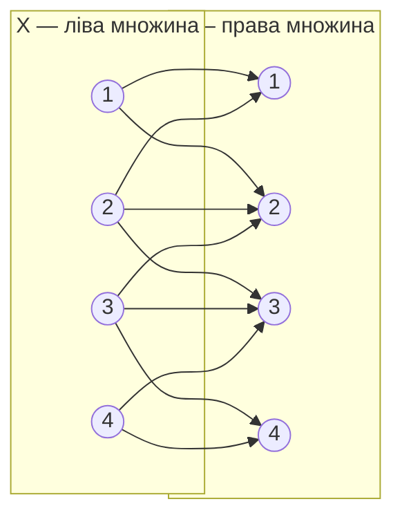
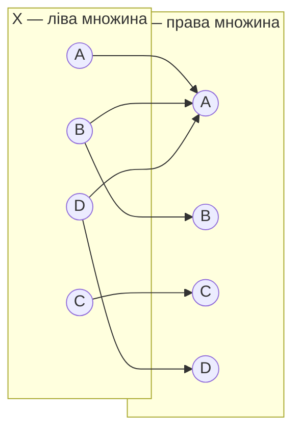
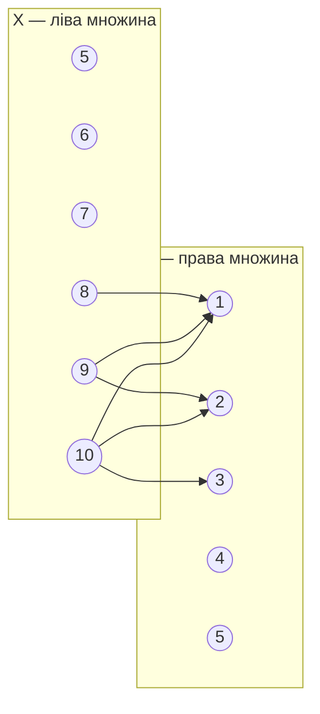
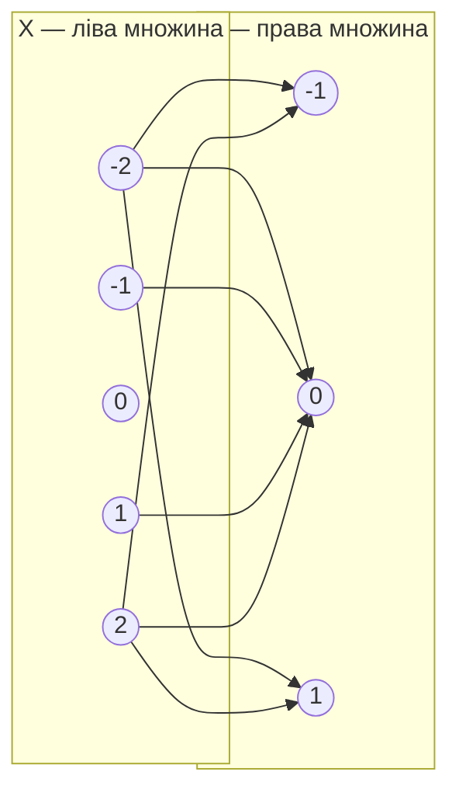
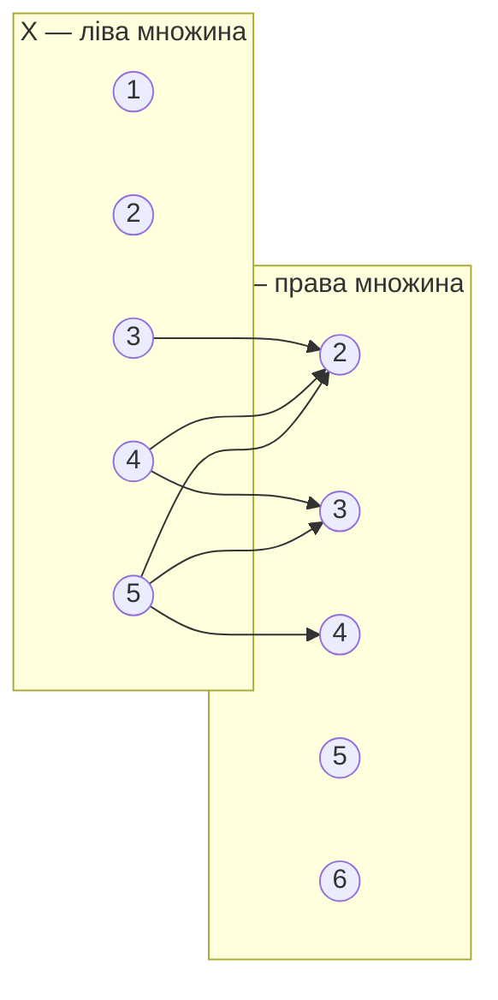
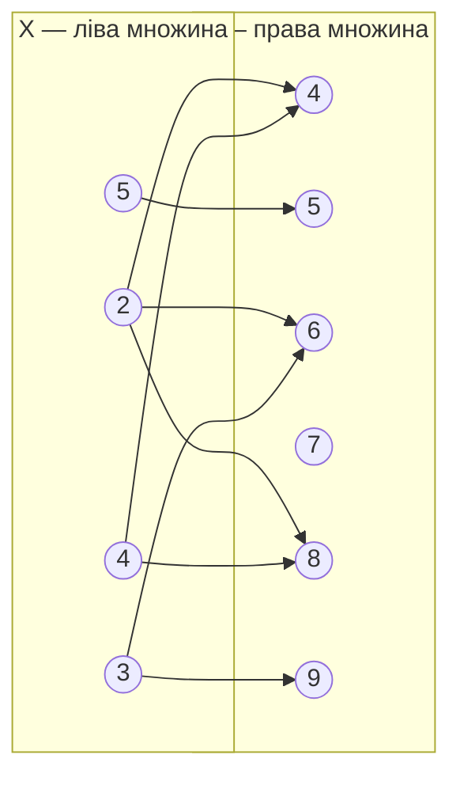
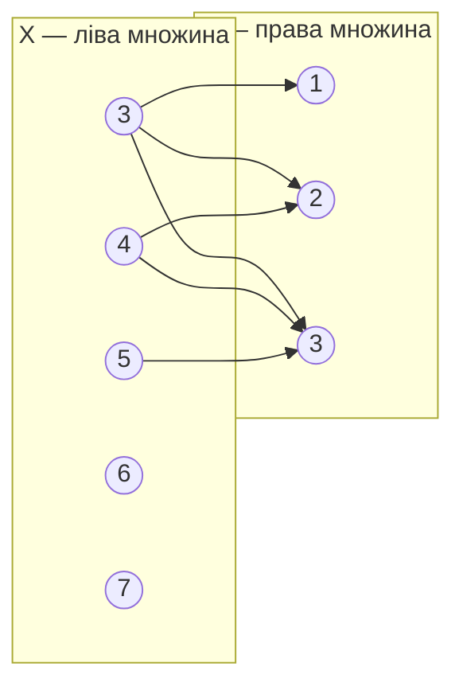
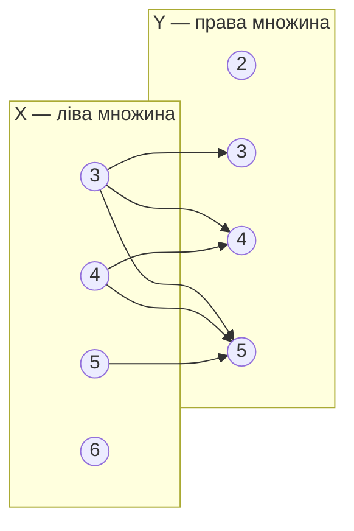
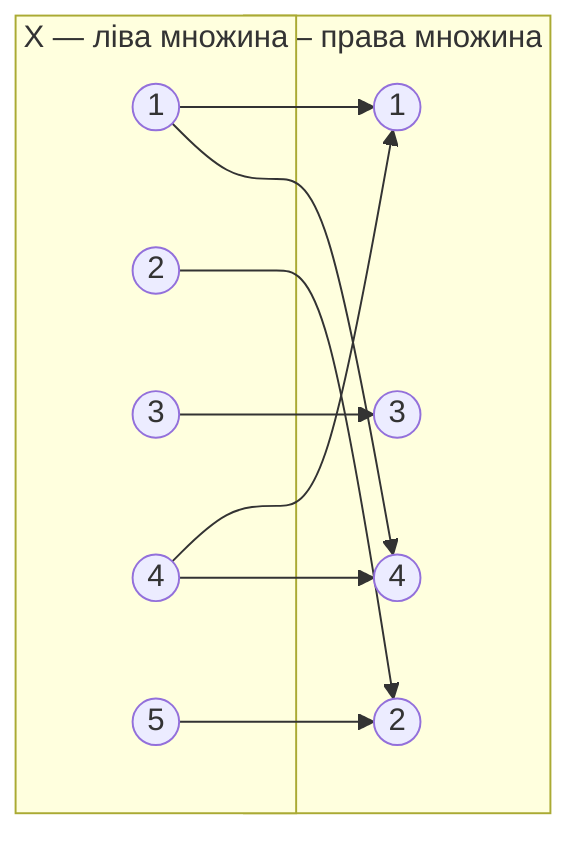

# Домашнє завдання 5
## Відношення: способи задання, область визначення і значень

У матрицях рядки відповідають елементам лівої множини, стовпці — правої, у вказаному порядку. Одиниця означає, що пара належить відношенню. На графах дві копії множин розміщено у два стовпчики; стрілка йде від першого елемента пари до другого. Ізольовані вершини залишено для відображення всіх елементів вихідних множин.

### Завдання 1.1

$X=\{1, 2, 3, 4\},\quad Y=\{1, 2, 3, 4\},\quad R=\{(x,y)\mid |x-y|\leq1\}$.

Перевіряємо, щоб різниця чисел за модулем не перевищувала 1.

**Перелік пар:**

$R=\{(1,1), (1,2), (2,1), (2,2), (2,3), (3,2), (3,3), (3,4), (4,3), (4,4)\}$.

**Матриця:**

| $x\backslash y$ | 1 | 2 | 3 | 4 |
|---|---|---|---|---|
| 1 | 1 | 1 | 0 | 0 |
| 2 | 1 | 1 | 1 | 0 |
| 3 | 0 | 1 | 1 | 1 |
| 4 | 0 | 0 | 1 | 1 |

**Дводольний граф:**

**Відповідь:** $D(R)=\{1, 2, 3, 4\},\quad E(R)=\{1, 2, 3, 4\}$.

---

### Завдання 1.2

$X=\{A, B, C, D\},\quad Y=\{A, B, C, D\},\quad R=\{(x,y)\mid x\setminus y=\varnothing\}$.

Маємо $x\setminus y=\varnothing \Leftrightarrow x\subseteq y$. Тут $A=\{0,1,2,3\}$, $B=\{0,2\}$, $C=\{1,3,4\}$, $D=\{1,2,3\}$. Крім включення кожної множини в себе, маємо $B\subseteq A$ та $D\subseteq A$.

**Перелік пар:**

$R=\{(A,A), (B,A), (B,B), (C,C), (D,A), (D,D)\}$.

**Матриця:**

| $x\backslash y$ | A | B | C | D |
|---|---|---|---|---|
| A | 1 | 0 | 0 | 0 |
| B | 1 | 1 | 0 | 0 |
| C | 0 | 0 | 1 | 0 |
| D | 1 | 0 | 0 | 1 |

**Дводольний граф:**

**Відповідь:** $D(R)=\{A, B, C, D\},\quad E(R)=\{A, B, C, D\}$.

---

### Завдання 2.1

$X=\{5, 6, 7, 8, 9, 10\},\quad Y=\{1, 2, 3, 4, 5\},\quad R=\{(x,y)\mid x-y>6\}$.

Умова рівносильна $b<a-6$.

**Перелік пар:**

$R=\{(8,1), (9,1), (9,2), (10,1), (10,2), (10,3)\}$.

**Матриця:**

| $x\backslash y$ | 1 | 2 | 3 | 4 | 5 |
|---|---|---|---|---|---|
| 5 | 0 | 0 | 0 | 0 | 0 |
| 6 | 0 | 0 | 0 | 0 | 0 |
| 7 | 0 | 0 | 0 | 0 | 0 |
| 8 | 1 | 0 | 0 | 0 | 0 |
| 9 | 1 | 1 | 0 | 0 | 0 |
| 10 | 1 | 1 | 1 | 0 | 0 |

**Дводольний граф:**

**Відповідь:** $D(R)=\{8, 9, 10\},\quad E(R)=\{1, 2, 3\}$.

---

### Завдання 2.2

$X=\{-2, -1, 0, 1, 2\},\quad Y=\{-1, 0, 1\},\quad R=\{(x,y)\mid x^2>y^2\}$.

Для $a=\pm2$ підходять усі $b$; для $a=\pm1$ — лише $b=0$; для $a=0$ пар немає.

**Перелік пар:**

$R=\{(-2,-1), (-2,0), (-2,1), (-1,0), (1,0), (2,-1), (2,0), (2,1)\}$.

**Матриця:**

| $x\backslash y$ | -1 | 0 | 1 |
|---|---|---|---|
| -2 | 1 | 1 | 1 |
| -1 | 0 | 1 | 0 |
| 0 | 0 | 0 | 0 |
| 1 | 0 | 1 | 0 |
| 2 | 1 | 1 | 1 |

**Дводольний граф:**

**Відповідь:** $D(R)=\{-2, -1, 1, 2\},\quad E(R)=\{-1, 0, 1\}$.

---

### Завдання 2.3

$X=\{1, 2, 3, 4, 5\},\quad Y=\{2, 3, 4, 5, 6\},\quad R=\{(x,y)\mid x>y\}$.

Вибираємо всі пари, у яких перше число більше за друге.

**Перелік пар:**

$R=\{(3,2), (4,2), (4,3), (5,2), (5,3), (5,4)\}$.

**Матриця:**

| $x\backslash y$ | 2 | 3 | 4 | 5 | 6 |
|---|---|---|---|---|---|
| 1 | 0 | 0 | 0 | 0 | 0 |
| 2 | 0 | 0 | 0 | 0 | 0 |
| 3 | 1 | 0 | 0 | 0 | 0 |
| 4 | 1 | 1 | 0 | 0 | 0 |
| 5 | 1 | 1 | 1 | 0 | 0 |

**Дводольний граф:**

**Відповідь:** $D(R)=\{3, 4, 5\},\quad E(R)=\{2, 3, 4\}$.

---

### Завдання 2.4

$X=\{2, 3, 4, 5\},\quad Y=\{4, 5, 6, 7, 8, 9\},\quad R=\{(x,y)\mid x\mid y\}$.

Для кожного $a$ вибираємо його кратні з правої множини.

**Перелік пар:**

$R=\{(2,4), (2,6), (2,8), (3,6), (3,9), (4,4), (4,8), (5,5)\}$.

**Матриця:**

| $x\backslash y$ | 4 | 5 | 6 | 7 | 8 | 9 |
|---|---|---|---|---|---|---|
| 2 | 1 | 0 | 1 | 0 | 1 | 0 |
| 3 | 0 | 0 | 1 | 0 | 0 | 1 |
| 4 | 1 | 0 | 0 | 0 | 1 | 0 |
| 5 | 0 | 1 | 0 | 0 | 0 | 0 |

**Дводольний граф:**

**Відповідь:** $D(R)=\{2, 3, 4, 5\},\quad E(R)=\{4, 5, 6, 8, 9\}$.

---

### Завдання 2.5

$X=\{3, 4, 5, 6, 7\},\quad Y=\{1, 2, 3\},\quad R=\{(x,y)\mid x-y<3\}$.

Умова рівносильна $b>a-3$.

**Перелік пар:**

$R=\{(3,1), (3,2), (3,3), (4,2), (4,3), (5,3)\}$.

**Матриця:**

| $x\backslash y$ | 1 | 2 | 3 |
|---|---|---|---|
| 3 | 1 | 1 | 1 |
| 4 | 0 | 1 | 1 |
| 5 | 0 | 0 | 1 |
| 6 | 0 | 0 | 0 |
| 7 | 0 | 0 | 0 |

**Дводольний граф:**

**Відповідь:** $D(R)=\{3, 4, 5\},\quad E(R)=\{1, 2, 3\}$.

---

### Завдання 2.6

$X=\{3, 4, 5, 6\},\quad Y=\{2, 3, 4, 5\},\quad R=\{(x,y)\mid x^2-y^2\leq0\}$.

Оскільки числа додатні, умова рівносильна $a\leq b$.

**Перелік пар:**

$R=\{(3,3), (3,4), (3,5), (4,4), (4,5), (5,5)\}$.

**Матриця:**

| $x\backslash y$ | 2 | 3 | 4 | 5 |
|---|---|---|---|---|
| 3 | 0 | 1 | 1 | 1 |
| 4 | 0 | 0 | 1 | 1 |
| 5 | 0 | 0 | 0 | 1 |
| 6 | 0 | 0 | 0 | 0 |

**Дводольний граф:**

**Відповідь:** $D(R)=\{3, 4, 5\},\quad E(R)=\{3, 4, 5\}$.

---

### Завдання 2.7

$X=\{1, 2, 3, 4, 5\},\quad Y=\{1, 2, 3, 4\},\quad R=\{(x,y)\mid x\equiv y\pmod3\}$.

Поєднуємо числа з однаковими остачами при діленні на 3.

**Перелік пар:**

$R=\{(1,1), (1,4), (2,2), (3,3), (4,1), (4,4), (5,2)\}$.

**Матриця:**

| $x\backslash y$ | 1 | 2 | 3 | 4 |
|---|---|---|---|---|
| 1 | 1 | 0 | 0 | 1 |
| 2 | 0 | 1 | 0 | 0 |
| 3 | 0 | 0 | 1 | 0 |
| 4 | 1 | 0 | 0 | 1 |
| 5 | 0 | 1 | 0 | 0 |

**Дводольний граф:**

**Відповідь:** $D(R)=\{1, 2, 3, 4, 5\},\quad E(R)=\{1, 2, 3, 4\}$.

---

