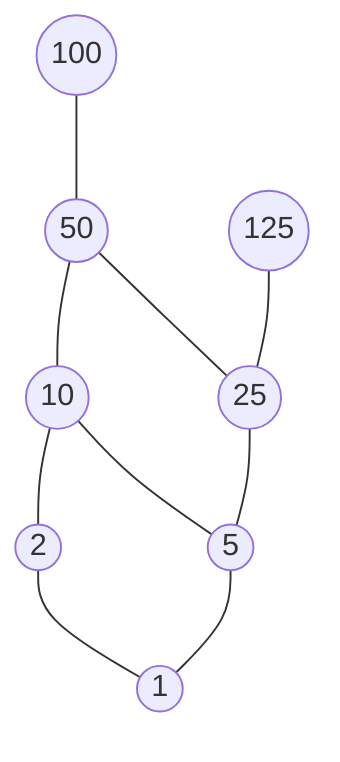
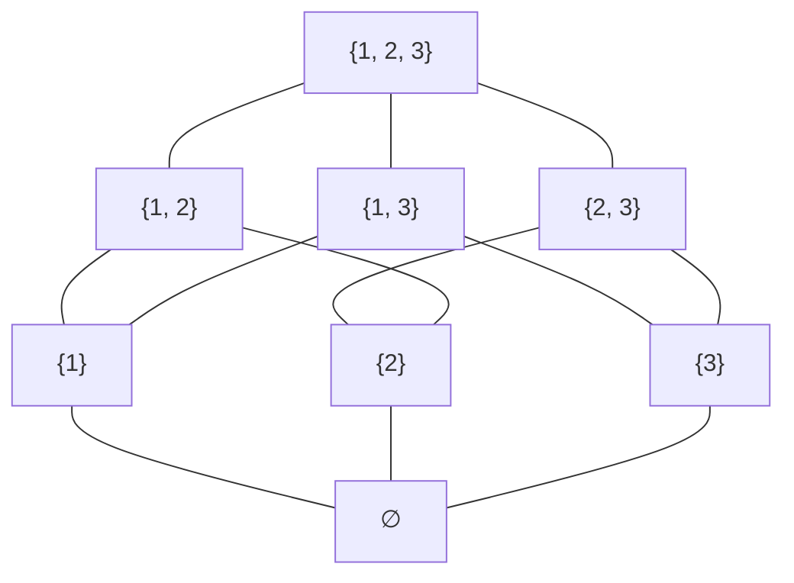
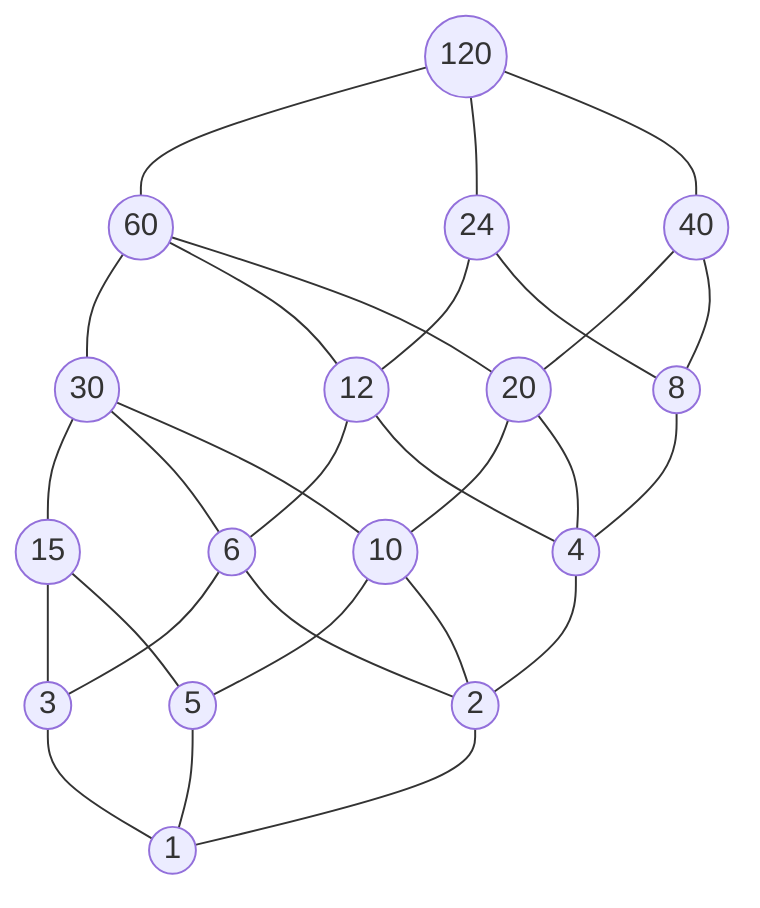

# Домашнє завдання 9
## Відношення порядку, діаграми Гассе, ґратки

### Завдання 1. Відношення порядку на ℤ

Для нестрогого порядку перевіряємо три властивості. Кожне число має бути у відношенні із собою (рефлексивність). Якщо a пов’язане з b і b пов’язане з a, то a = b (антисиметричність). Якщо a пов’язане з b, а b з c, то a має бути пов’язане з c (транзитивність).

1. **R1, a ≤ b.** Це нестрогий порядок. Маємо a ≤ a. З a ≤ b і b ≤ a випливає a = b. З a ≤ b і b ≤ c випливає a ≤ c.
2. **R2, a ≥ b.** Це теж нестрогий порядок. Маємо a ≥ a. Якщо a ≥ b і b ≥ a, то a = b. Якщо a ≥ b і b ≥ c, то a ≥ c.
3. **R3, a < b.** Це строгий порядок. Нерівність a < a завжди хибна, а з a < b і b < c випливає a < c.
4. **R4, a² ≤ b².** Порядку немає. Наприклад, (−2)² = 2² = 4. Тому відношення виконується в обидва боки для −2 і 2, хоча −2 ≠ 2. Порушена антисиметричність.
5. **R5, a = b.** Це нестрогий порядок. Кожне число дорівнює собі. Антисиметричність випливає із самої рівності. Якщо a = b і b = c, то a = c.
6. **R6, a ділиться на b.** На цілих числах порядку немає. Число 2 ділиться на −2, і −2 ділиться на 2. Числа різні, тому порушена антисиметричність.
7. **R7, НСД(a, b) = 1.** НСД(2, 2) = 2, тому відношення не рефлексивне. Транзитивність теж порушена. НСД(2, 3) = НСД(3, 4) = 1, але НСД(2, 4) = 2. Порядку немає.

Отже, R1, R2 і R5 є нестрогими порядками, а R3 є строгим порядком.

### Завдання 2. Чи є множина ґраткою?

Для ґратки кожна пара повинна мати інфімум (найбільшу нижню межу) і супремум (найменшу верхню межу) в самій множині.

1. **Числа від 1 до 8, порядок ≤.** Для будь-яких двох чисел менше з них є інфімумом, а більше — супремумом. Наприклад, для 3 і 7 це 3 і 7. Обидва числа завжди належать множині, тому це ґратка.
2. **Множина {1, 2, 3, 5, 6, 10, 15, 30}, порядок за подільністю.** Це всі додатні дільники числа 30. Інфімум двох дільників — їхній найбільший спільний дільник (НСД), а супремум — найменше спільне кратне (НСК). Обидва теж ділять 30. Наприклад, для 6 і 10 маємо НСД = 2, НСК = 30. Отже, це ґратка.
3. **Множина {2, 3, 4, 6, 8, 9, 12, 18, 24, 36}, порядок за подільністю.** Візьмемо 2 і 3. Їхній єдиний спільний додатний дільник — 1, а його тут немає. Для цієї пари немає нижньої межі, тому множина не є ґраткою.

### Завдання 3. Діаграми Гассе

Діаграми читаємо знизу вгору. Два елементи з’єднані лінією, якщо між ними немає проміжного елемента з цієї множини.

#### 1. Подільність на {1, 2, 5, 10, 25, 50, 100, 125}

Наприклад, між 5 і 50 є 10, тому 5 і 50 напряму не з’єднуємо. Для 100 і 125 у множині немає числа, яке ділиться на обидва. Ця пара не має супремуму, тому множина не є ґраткою.

#### 2. Підмножини {1, 2, 3}, порядок за включенням

Кожен крок угору додає один елемент. Для будь-яких двох підмножин їхній перетин є інфімумом, а об’єднання — супремумом. Наприклад, для {1, 2} і {2, 3} отримуємо {2} та {1, 2, 3}. Обидва результати є підмножинами {1, 2, 3}, тому це ґратка.

#### 3. Дільники числа 120, порядок за подільністю

120 = 2³ · 3 · 5. Його додатні дільники утворюють множину {1, 2, 3, 4, 5, 6, 8, 10, 12, 15, 20, 24, 30, 40, 60, 120}.

Крок угору множить дільник на 2, 3 або 5 так, щоб результат теж ділив 120. Наприклад, з 4 можна перейти до 8, 12 і 20.

Для будь-яких двох дільників їхні НСД і НСК теж ділять 120. Отже, кожна пара має інфімум і супремум, тому це ґратка. Наприклад, для 8 і 30 інфімум дорівнює 2, а супремум — 120.
